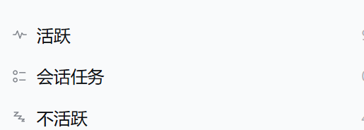

# dsh-sidebar-sections

> **Unofficial community plugin.** This package is not published by, reviewed by
> or endorsed by DeepSeek. It **reuses** the MIT-licensed official
> `@deepseek-ai/dsh-client-ui-workspace` **0.2.1-rc.2** browser bundle and
> patch-builds its own copy of it. Where this documentation says "official", it
> refers to that upstream DeepSeek code (the shipped sidebar browser / its
> shipped view), never to this plugin.

Fork of the shipped DSH sidebar workspace browser. The official
`@deepseek-ai/dsh-client-ui-workspace` **0.2.1-rc.2** client bundle is vendored
byte-for-byte, and an ordered patch pipeline derives `lib/client.js` that adds a
three-section layout on top of it:

**Active -> Session tasks -> Inactive**, with the official search, archive
filters, row menus, hover buttons/cards, workspace management, drag & drop,
watermark rows, status dots and shortcuts kept intact because they are still the
official code.

> **Status (0.2.7, tested on DSH Desktop 0.2.1-rc.2, Windows).** The sectioned
> sidebar renders in the running app (`活跃` header + count over the official
> project rows), the official child-slot registrations stay live (session menu
> rows, row hover actions, directory flow, hero picker, toast factory), and the
> native render path was exercised in the running app. Pointer interaction
> (opening menus, dragging, threshold buttons) is the remaining human
> walk-through; see [docs/official-parity.md](docs/official-parity.md).

## Compatibility

- DSH: `>=0.2.1-rc.2 <0.3.0` (declared as `dsh.engines.dsh`). The browser half
  is generated from the 0.2.1-rc.2 official bundle; a newer DSH release needs the
  baseline re-extracted and the patch anchors re-checked
  ([docs/upgrade-checklist.md](docs/upgrade-checklist.md)).
- The fixed middle segment is a real workspace at the Windows path
  `D:\files\history-tasks` (title `会话任务`). The plugin is therefore
  Windows-oriented today: on another platform that literal path is not a normal
  directory. Everything else is platform-neutral.
- While enabled, this bundle disables the shipped `ui-workspace` loader row and
  runs the official browser code itself; disabling or uninstalling the bundle
  restores the shipped row unchanged. The official package files are never
  modified.

## Why the plugin replaces the shipped plugin row

The official browser owns `sidebar.workspaces` **and declares that region's child
slots** (session "..." menu rows, row hover actions, directory flow, row
leading/hover cells). The slot ledger allows only one registration to declare a
given child slot, and the renderer only authorises a registration to render the
children it declared itself. A second, lower-priority occupant therefore cannot
reuse those slots - it would have to redraw the menus and dialogs, which is
exactly what this rewrite is meant to avoid.

So this bundle is a **replacement**: its `cordis.patch.yml` disables the shipped
`ui-workspace` loader row while the bundle is enabled, and the bundle runs the
official client code itself with the section patches. The official package in
`app.asar` is never modified. Disabling or uninstalling the bundle removes its
patch layer and the shipped row returns unchanged.

"Switch back to the official list" is a rendering mode of the same patched
component tree (`sections.mode === "native"` -> the official derivation and
render path), not a second registration; the full-screen list looks and behaves
exactly like the shipped one, keeps the official view state, and survives a page
refresh.

## Layout

~~~
dsh-sidebar-sections/
|- package.json              plugin manifest (dsh.bundle.patch + dsh.client)
|- cordis.patch.yml          disables the shipped ui-workspace row, inserts this bundle's row
|- icon.svg / locale/*.json  plugin manifest icon + strings
|- lib/index.js              host half: mkdir -p D:/files/history-tasks
|- lib/client.js             GENERATED by scripts/build-client.mjs (never hand-edit)
|- vendor/                   byte copy of the official 0.2.1-rc.2 client.js
|- patches/manifest.json     baseline sha256/bytes + ordered patch list
|- patches/01..04,06-*.mjs   pure apply(source) -> source patch modules (05 retired)
|- scripts/build-client.mjs  verify -> apply -> node --check -> write lib/client.js
|- scripts/smoke-load.mjs    materialise the bundle against the frozen seed table
|- scripts/derive-selftest.mjs  unit tests for the section derivation rules
|- scripts/install.ps1       dry-run/install/uninstall runbook (no profile writes by default)
|- docs/                     parity, upgrade checklist, patch reference
~~~

## Build and test

Requirements: Node.js 24 (this machine: `C:\Program Files\nodejs\node.exe`).
Run from the plugin directory (or pass the absolute path).

~~~powershell
# Full build: verifies the vendored baseline sha256, applies all patches in order,
# runs node --check, then writes lib/client.js.
node scripts/build-client.mjs

# Apply + node --check only; lib/client.js is not written.
node scripts/build-client.mjs --check-only

# Verification suite.
node scripts/smoke-load.mjs        # frozen platform module table / bundle shape
node scripts/derive-selftest.mjs   # SPEC 2.1 derivation rules (22 assertions)
~~~

The build:

1. reads `patches/manifest.json`;
2. verifies the vendored baseline **bytes and SHA256** (first 16 hex chars must be
   `4DD7F3C580F2316A`); on mismatch it fails and prints the re-extract commands;
3. imports each patch module in manifest order and calls `apply(source)`;
   every patch asserts its anchors and throws if an anchor is not unique;
4. writes the result to a temporary file and runs `node --check`;
5. writes `lib/client.js` (unless `--check-only`) and prints per-patch byte
   deltas, final bytes and the output SHA256.

**`lib/client.js` is a generated artifact - never hand-edit it.** Every change
lands in `vendor/` (baseline refresh) or `patches/*.mjs`.

## Install / enable / disable / uninstall

Installing is a profile operation: the package declares `dsh.bundle.patch`, so
`dsh plugin add` links it into the profile and appends
`dsh-sidebar-sections` to `dsh.profile.bundles`. Use the profile you
actually run (the Desktop app uses `desktop`; `dsh web` commonly uses `web`).

~~~powershell
# From npm (after the package is published):
dsh plugin --profile <profile> add dsh-sidebar-sections

# From the GitHub repository (no npm publication needed):
dsh plugin --profile <profile> add github:<owner>/dsh-sidebar-sections

# From a local checkout (development):
dsh plugin --profile <profile> add <path-to-this-repo>
~~~

On the Desktop app, quit the app before running the CLI (profile files are
locked), or use the in-app plugin manager. After the bundle is selected, the
browser half loads on the next client boot; a page refresh (or
disable -> enable) picks up a rebuilt `lib/client.js`.

### Enable / disable

- **In the app:** Settings -> Plugins -> toggle
  `dsh-sidebar-sections`; or
- **as an agent tool:** `plugin_manager` `{ "action": "set_bundle",
  "target": "dsh-sidebar-sections", "enabled": false }` (then `true`
  to re-enable); or
- profile fallback: leave the package out of `dsh.profile.bundles`.

Disabling the bundle removes its patch layer, which re-enables the shipped
`ui-workspace` row - the official sidebar returns. Re-enabling mounts the
sections build again and is also the way to pick up a rebuilt `lib/client.js`
while the app is running (the client bundle reloads live when the profile
bundle list changes).

### Uninstall

~~~powershell
dsh plugin --profile <profile> remove dsh-sidebar-sections
~~~

This removes the dependency and drops the package from `dsh.profile.bundles`;
the official browser returns.

## Using it

- The workspace list is split into **活跃 / 会话任务 / 不活跃** (fixed order).
  Each section header shows its own icon (Active = ECG trace, Session tasks =
  task checklist, Inactive = descending zzz) and a count; the icon is blue while
  the section is expanded and keeps the normal muted colour while collapsed, and
  the collapse chevron appears on hover/selection exactly like the official rows.
  Inactive workspaces are collapsed by default.
- In the sectioned view every project row is inset 21px under its section
  header, aligning the project folder icon's centre axis with the first glyph of
  the section label; the row hover/selected background uses the same inset (the
  section headers stay at the left edge). Native mode uses the shipped layout.
- **View options** ("..." / sliders icon next to the workspace search button):
  - "分段": switch between the sectioned view and the official list;
  - "活跃阈值 · N 天": decrease / increase / reset (1-90 days, default 7);
  - followed by the official group-by / order / archive-filter items.
- **Pins:** the workspace row "..." menu gets "钉到活跃 / 钉到不活跃 / 取消钉住"
  in the sectioned view. A pin always wins over the threshold and over the
  running/pending automatic rule.
- **会话任务**: a real workspace at `D:\files\history-tasks`, titled `会话任务`.
  It is the fixed middle section, renders its sessions flat, and its section
  header has a `+` that starts a new session there. The host half creates the
  directory; the browser half registers + renames the workspace through the
  official `workspaces.create` / `workspaces.rename` APIs (once).
- **Switch back to the official list** from the view options. While the official
  list is shown, a return button appears at the sidebar foot (order 400 in
  `sidebar.footer.action`) and switches back to sections.

## State and data boundaries

- Plugin-owned localStorage key: `dsh.workspace.sections.v2` - `mode`,
  `activeDays`, `pins`, `sectionCollapsed`. Remove it to reset to defaults.
- Official view state `dsh.workspace.view.v5` is read/written only by the
  official code path (now in this bundle), exactly as before; no schema change.
- The only official data write is the fixed-section workspace registration and
  rename through the official APIs. No migration, no `defaultWorkspaceId`
  change.

## Runtime dependencies

None beyond the web shell's frozen platform seed modules - `react`,
`react/jsx-runtime`, `@deepseek-ai/cordis`, `@deepseek-ai/dsh-client-store`,
`@deepseek-ai/dsh-client-ui-primitives` - all present in the frozen module table,
so no `dsh.client.external` declaration is needed. Proof and a re-verification
command: [docs/upgrade-checklist.md](docs/upgrade-checklist.md) section 2.

## Screenshots

## Documentation

- [CHANGELOG.md](CHANGELOG.md) - package versions and patch-level changes
- [docs/patches.md](docs/patches.md) - architecture, every patch, anchors, verification log
- [docs/official-parity.md](docs/official-parity.md) - official capability parity + remaining human checklist
- [docs/baseline.md](docs/baseline.md) - baseline provenance, hashes and re-extraction
- [docs/acceptance-2026-10-22.md](docs/acceptance-2026-10-22.md) - authoring-session
  acceptance record (automated/live evidence, unverified interactions, risks)
- [docs/upgrade-checklist.md](docs/upgrade-checklist.md) - baseline extraction,
  contract checks, patch replay, module-table proof, profile state
- [docs/publish.md](docs/publish.md) - how this package is released to the
  community list (`awesome-dsh-plugin` / dsh-market)

## License

MIT for this package's patch pipeline, host half and docs. The vendored browser
artifact is the official MIT-licensed
`@deepseek-ai/dsh-client-ui-workspace` 0.2.1-rc.2 release (Copyright (c) 2026
DeepSeek); its license is included at
[`vendor/LICENSE.dsh-client-ui-workspace`](vendor/LICENSE.dsh-client-ui-workspace)
and summarised in [THIRD-PARTY-NOTICES.md](THIRD-PARTY-NOTICES.md). The icon is
original.
